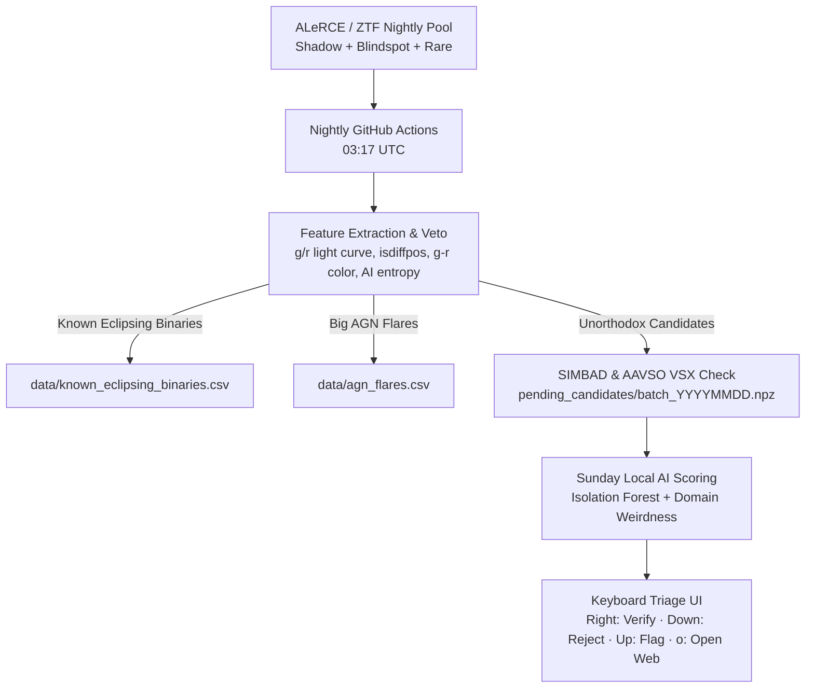
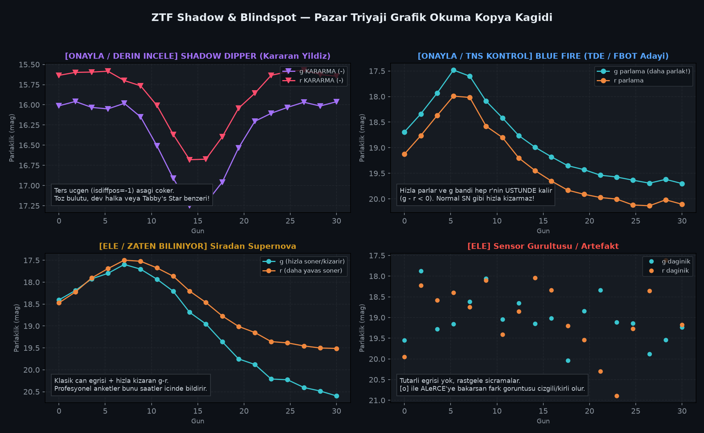

# ZTF Shadow & Blindspot Hunter


**Part III of the Sunday Hunter Trilogy** — after chasing exoplanets in space ([TESS Planet Hunter](https://github.com/CemreMetin/tess-planet-hunter)) and buried Roman walls under Anatolian wheat fields ([Subsurface Ghost Hunter](https://github.com/CemreMetin/Subsurface-ghost-hunter)), I pointed my Sunday coffee ritual back up at the night sky, this time with **ZTF (Zwicky Transient Facility)**.

The original plan was simple: if I can't name a planet, maybe I can at least catch a fresh **supernova**. New ones explode every night in open ZTF data, so the odds looked great — right up until I realized every automated broker on Earth already runs `SN probability > 0.70` and reports the obvious ones to TNS before I've even finished brushing my teeth.

Instead of racing billion-dollar survey pipelines for textbook explosions, I built a nightly bot that **rummages through ZTF's recycling bin**. Every night, a free GitHub Actions worker scans ALeRCE for the two things most supernova pipelines throw away or gloss over — **stars that suddenly go dark** (`isdiffpos = -1`) and **weird events where two AIs can't agree on what they're looking at** — cross-checks them against **SIMBAD** and **AAVSO VSX**, and packs the best candidates into tiny `.npz` files for a 15-minute Sunday keyboard review.

### The Sunday Hunter Trilogy
| Part | Project | What It Hunts | Open Data |
| :---: | :--- | :--- | :--- |
| **I** | [TESS Planet Hunter](https://github.com/CemreMetin/tess-planet-hunter) | Undiscovered exoplanets | NASA TESS |
| **II** | [Subsurface Ghost Hunter](https://github.com/CemreMetin/Subsurface-ghost-hunter) | Buried Roman foundations in Niğde | ESA Sentinel-2 |
| **III** | **ZTF Shadow & Blindspot Hunter** *(this repo)* | Suddenly dimming stars & AI blind spots | ZTF / ALeRCE |

---

### My Twist on the Idea

- **Hunt shadows, not just explosions (`isdiffpos = -1`):** Almost every supernova bot immediately discards negative difference-image alerts (stars getting *fainter* than the reference image). That's exactly where mysterious dimming events — **Tabby's Star (Boyajian's Star)** analogs, giant planetary ring systems like J1407b, disintegrating planet debris, and dust-obscured young stars — hide. It felt like the natural sequel to hunting planet transits with TESS.
- **Hunt the AI's blind spots:** Instead of asking ALeRCE for objects it's 95% sure about, I look for objects where its image classifier (`stamp_classifier`) and light-curve classifier (`lc_classifier`) **disagree**, where the classifier's Shannon entropy is sky-high ("no idea what this is"), or where a transient stays unusually **blue and hot (`g - r < -0.10`)** instead of cooling down like a normal supernova.
- **Automatic novelty check (SIMBAD + AAVSO VSX):** Every candidate is queried against SIMBAD and VizieR's AAVSO VSX catalog automatically. Anything missing from both gets an `UNCATALOGED` badge and a weirdness boost — because if I can't name a planet, maybe I can at least log an uncataloged variable star.
- **Keep the byproducts:** Obvious eclipsing binaries (`data/known_eclipsing_binaries.csv`) and big AGN flares (`data/agn_flares.csv`) get saved as bonus datasets instead of being thrown away.

---

## How It Works

Just like my TESS pipeline, I kept the cloud worker super lightweight (no heavy ML libraries in CI) and split everything into **three stages**:



- **Stage 1 — Nightly Cloud Autopilot (`pipeline/worker.py`):** Runs every night at `03:17 UTC` on GitHub Actions, shuffles across Shadow, Blindspot, and rare transient pools, filters out sensor bogus and boring textbook objects, queries SIMBAD + AAVSO VSX, and commits a compact `.npz` batch back to the repo.
- **Stage 2 — Local Weirdness Scorer (`ai/weirdness.py`):** On Sunday, merges the week's `.npz` batches and ranks every candidate using a blend of **65% physical/AI weirdness** (dimming depth, model conflict, entropy, blue color, uncataloged bonus) and **35% unsupervised Isolation Forest** outlier scoring.
- **Stage 3 — Sunday Keyboard Review (`triage.py`):** Dark-mode matplotlib UI showing the `g` and `r` band light curve (brightening as circles `o`, **dimming as downward triangles `v`**), the `g - r` color evolution, and the AI conflict breakdown. Press `o` to instantly open **ALeRCE**, **Legacy Survey**, **TNS**, and **AAVSO VSX** in your browser for the current target.

### Reading the Plots (`triage_cheat_sheet.png`)

Since I'm still learning to read astronomical light curves by eye, I also wrote a quick script (`scripts/make_cheat_sheet.py`) to generate a side-by-side reference card:



---

## Real Bugs I Hit While Testing Live Data

- **The entropy calibration trap:** On my first live ALeRCE run, `lc_entropy >= 0.60` let 15 out of 20 objects straight through. Because `lc_classifier` splits probabilities across 15 classes, most normal variable stars sit around `0.65–0.82`. Tightening it to `>= 0.85` immediately cut the noise down to genuinely confused objects.
- **Pool starvation:** Initially the worker processed the `YSO` query before everything else, so the nightly cap filled up before ever reaching the `Blindspot` and `Blue Fire` pools. Shuffling the combined pool deterministically per day fixed the balance right away.
- **Catalog TAP endpoints:** My first SIMBAD/VizieR TAP URLs timed out silently and returned `CHECK_FAILED` for every target. Switching to `simbad.u-strasbg.fr` (with a Harvard mirror fallback) and VizieR's lightweight `asu-tsv` cone-search endpoint made cross-matching fast and reliable.

---

## Want to Run It Yourself?

### 1. Local setup (one-time)
```bash
git clone https://github.com/CemreMetin/ztf-shadow-hunter.git
cd ztf-shadow-hunter

python -m venv venv
# Windows PowerShell:
.\venv\Scripts\Activate.ps1
# macOS / Linux:
# source venv/bin/activate

pip install -r requirements.txt
```

### 2. Turn on the nightly GitHub Actions autopilot
1. Go to **Settings → Actions → General → Workflow permissions** and enable **Read and write permissions**.
2. Go to **Actions → Nightly ZTF Shadow & Blindspot Hunter → Run workflow** to trigger your first run manually (or just wait for `03:17 UTC`).

### 3. Your Sunday routine (~15 min)
```bash
git pull
python -m ai.weirdness
python triage.py
```

**Keyboard controls inside `triage.py`:**
- `Right` — Verify / Interesting (`triage_logs/verified_candidates.csv`)
- `Down` — Reject (`triage_logs/rejected_candidates.csv`)
- `Up` — Flag for deeper follow-up (`triage_logs/flagged_candidates.csv`)
- `Left` — Undo
- `o` — Open **ALeRCE + Legacy Survey + TNS + AAVSO VSX** in your browser
- `q` / `Esc` — Save & quit

---

## Project Layout

```text
.
├── .github/workflows/nightly_hunt.yml   # Nightly 03:17 UTC GitHub Actions job
├── pipeline/
│   ├── features.py                      # 10 physical/AI features & 64-pt LC packer
│   ├── vetos.py                         # Shadow/Blindspot rules & byproduct split
│   ├── catalog.py                       # SIMBAD + AAVSO VSX novelty checker
│   └── worker.py                        # Nightly ALeRCE harvester
├── ai/
│   └── weirdness.py                     # Isolation Forest + domain weirdness scorer
├── scripts/
│   └── make_cheat_sheet.py              # Generates triage_cheat_sheet.png
├── triage.py                            # Dark-mode keyboard candidate reviewer
├── requirements-worker.txt              # Lightweight CI dependencies
└── requirements.txt                     # Full local environment (scikit-learn + matplotlib)
```

---

## Credits
- Alert stream and broker APIs by **ZTF (Zwicky Transient Facility)** and **ALeRCE**.
- Catalog cross-matching via **CDS SIMBAD**, **VizieR**, and **AAVSO VSX**.
- Built as the spiritual sequel to [TESS Planet Hunter](https://github.com/CemreMetin/tess-planet-hunter), designed, debugged, and calibrated using **Google Antigravity**.
