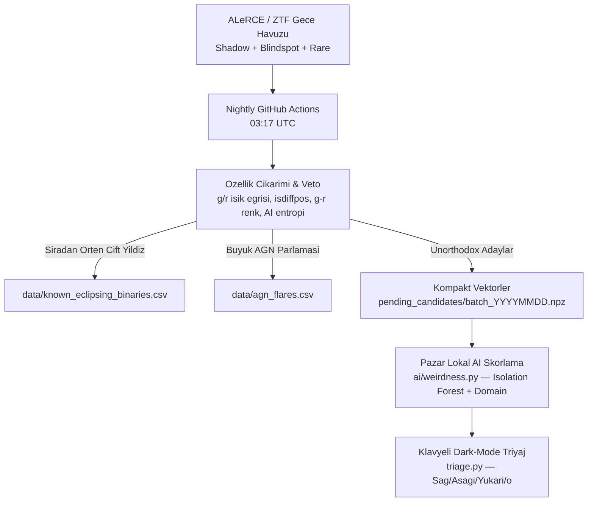

# 🌑 ZTF Shadow & Blindspot Hunter


**Herkesin baktığı bariz süpernovaları bilinçli olarak es geçen, iki unorthodox gökyüzü sinyaline odaklanan otomatik ZTF avcısı.**

### Hikâye: Neden Düz Bir Süpernova Botu Değil?

[TESS Planet Hunter](https://github.com/CemreMetin/tess-planet-hunter) projesinde NASA TESS verilerinden periyodik gezegen geçişleri avladıktan sonra, sıradaki adım olarak ZTF (Zwicky Transient Facility) verilerine geçmek istedim. Ama kısa sürede şunu fark ettim: ZTF'de herkes `SN > 0.70` filtresiyle **bariz, ders kitabı süpernovalara** bakıyor — onları da büyük gözlemevleri zaten saatler içinde TNS'ye bildirip kapatıyor.

Aynı otoyolda sıraya girmek yerine **tam tersini** yapan bir sistem kurdum:

1. **🌑 Track A — Shadow (Aniden Kararan Yıldızlar / `isdiffpos = -1`):**
   Süpernova avcıları negatif fark alarmlarını (referans görüntüye göre *kararan* yıldızları) doğrudan çöpe atar. Oysa **Tabby's Star (Boyajian's Star)** benzeri gizemli kararmalar, **dev halka sistemli ötegezegenler (J1407b)**, **parçalanan gezegen enkazları** ve **toz püskürten yıldızlar** tam bu negatif sinyallerde saklanır. TESS'teki gezegen geçişi avının doğrudan ruhani devamı.
2. **🧠 Track B — AI Blindspot (Yapay Zekânın Kafası Karışanlar & Mavi Ateş):**
   ALeRCE'nin görüntüye bakan yapay zekâsı (`stamp_classifier`) ile ışık eğrisine bakan yapay zekâsının (`lc_classifier`) **birbiriyle kavga ettiği**, yüksek belirsizlik (Shannon entropisi) ürettiği veya normal süpernovalar gibi kızarmak yerine haftalarca **aşırı mavi (`g - r < -0.10`)** kalan nadir olayları (TDE, FBOT, yetim patlamalar) avlar.
3. **♻️ Çöpe Atma, Yan Ürün Biriktir:**
   Filtreye takılan sıradan örten çift yıldızlar `data/known_eclipsing_binaries.csv`, büyük kuasar/AGN parlamaları ise `data/agn_flares.csv` dosyasında ayrı veri setleri olarak biriktirilir.

---

## Mimari (3 Aşama)



- **Aşama 1 — Gececi Bulut Otopilotu (`pipeline/worker.py`):** Her gece `03:17 UTC`'de GitHub Actions çalışır (`requirements-worker.txt` — hafif, sıfır maliyet), yeni adayları sıkıştırılmış `.npz` olarak `pending_candidates/` içine commit eder.
- **Aşama 2 — Lokal Tuhaflık Skorlayıcı (`ai/weirdness.py`):** Pazar günü hafta boyu biriken `.npz` paketlerini birleştirir; **%65 fiziksel/AI belirsizlik + %35 unsupervised Isolation Forest outlier skoru** ile en tuhaf adayları en başa dizer.
- **Aşama 3 — Klavyeli Pazar Triyajı (`triage.py`):** Solda `g`/`r` ışık eğrisi (parlamalar `o`, **kararmalar ters üçgen `v`**), sağ üstte **`g - r` renk evrimi**, sağ altta **AI kavga & tuhaflık barları**. Tek tuşla (`[o]`) ALeRCE + Legacy Survey + TNS sekmelerini açar.

---

## Kurulum ve Pazar Rutini

### 1. Lokal Ortam (Tek Seferlik)
```bash
python -m venv venv
# Windows PowerShell:
.\venv\Scripts\Activate.ps1

pip install -r requirements.txt
```

### 2. Grafik Okuma Kopya Kağıdını Oluştur
```bash
python scripts/make_cheat_sheet.py
```
`triage_cheat_sheet.png` dosyası **Kararan Yıldız (Shadow)**, **Mavi Ateş (TDE/FBOT)**, **Sıradan Süpernova** ve **Gürültü** grafiklerini yan yana özetler.

### 3. GitHub Actions'ı Aç
1. Public GitHub reposunda **Settings → Actions → General → Workflow permissions** → **Read and write permissions** aç.
2. **Actions → Nightly ZTF Shadow & Blindspot Hunter → Run workflow** ile ilk gece paketini hemen test et.

### 4. Pazar Rutinin (15–30 Dakika)
```bash
git pull
python -m ai.weirdness
python triage.py
```

**Triyaj Tuşları:**
- `[Sağ]` Onayla (`triage_logs/verified_candidates.csv`)
- `[Aşağı]` Ele (`triage_logs/rejected_candidates.csv`)
- `[Yukarı]` Derin İncele / Şüpheli (`triage_logs/flagged_candidates.csv`)
- `[Sol]` Geri Al
- `[o]` Tarayıcıda **ALeRCE + Legacy Survey + TNS** aç
- `[q]` Kaydet ve Çık
